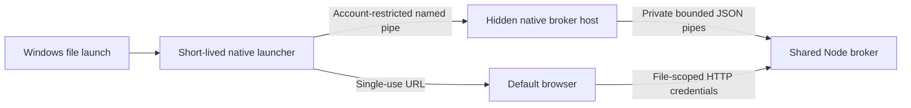

# Windows process and session lifecycle

## Why this follows the broker and precedes rendering

Step 5 made file access consistent and individually authorized. Step 6 adds one owner of those sessions across native launches. Integrating parsers before that owner existed would multiply memory budgets, complicate cancellation, and make a failed launch capable of disturbing unrelated views. Renderer integration can now use one stable registration, authorization and shutdown contract.

One installation path and Windows login session share one host and one Node runtime. A different package copy has a separate namespace, avoiding collisions between development and installed builds. Limits are shared within this scope, not across every copy or login on the machine.

## Startup, authorization and ownership

1. The native launcher resolves the selected file path and acquires a user-restricted startup mutex. It connects to an existing host or starts the fixed GUI executable with `--broker-host`, hidden through Windows ShellExecute. No file path is interpolated into that command.
2. A separate lifetime mutex prevents duplicate hosts. Names contain a protocol version, current user SID, Windows session ID and hash of the executable path. They contain no document name or credential. Mutex ownership is released by Windows on process death; there is no persisted PID/lock file to delete.
3. Named-pipe permissions explicitly allow the current SID and deny the network SID, with inherited ACLs disabled. Both ends verify peer process identity and Windows session; the launcher also checks the host executable path. Windows supports explicit named-pipe access controls and server process identification. [Microsoft: named-pipe security](https://learn.microsoft.com/en-us/windows/win32/ipc/named-pipe-security-and-access-rights), [GetNamedPipeServerProcessId](https://learn.microsoft.com/en-us/windows/win32/api/winbase/nf-winbase-getnamedpipeserverprocessid).
4. The host owns exactly one private Node child, starts it by absolute path, and clears NODE_OPTIONS/NODE_PATH. Browser requests never reach the path-registration channel. Native control messages and responses are newline-delimited UTF-8 JSON capped at 64 KiB, with bounded waits.
5. The host serializes control requests. It reads the complete Node response before accepting another command, including when the initiating launcher disconnects. This prevents a later caller receiving an earlier file's bootstrap URL. Malformed client requests do not kill existing sessions.
6. The launcher opens the returned loopback URL in the default browser and exits. Browser-launch failure attempts to revoke just that registration. It never kills a host that may own other files. If revocation cannot connect, the unredeemed bootstrap expires after 60 seconds.

Local same-account malware remains outside the threat model. A predictable pipe name is not an authorization secret. ACL and peer checks limit access by other accounts, but a full second-account adversarial test remains a release gate.

## Session and process transitions

| State/event | Behavior |
| --- | --- |
| Registered, no browser redemption | Single-use bootstrap expires after 60 seconds |
| Authenticated view | 45-minute idle lease, eight-hour absolute lifetime |
| Visible page | Minute heartbeat renews idle activity |
| Background page with no timers | Snapshot/credential remain valid for 45 minutes since last activity; required 30-minute interval fits |
| Focus, pageshow, online or visibility return | Check the existing session; reload initial content if a previous load failed |
| Temporary connection failure | Preserve text, offer Retry connection and Windows reopen instructions |
| Credential expired | Remove tab credential, stop retries, preserve loaded text with explicit reopen instructions |
| End viewing session | Clear local text/credential immediately; revoke server session if reachable |
| All sessions gone | Broker exits after approximately five seconds; native host observes child exit and exits |
| Browser closes without unload | Lease expires normally; shutdown does not depend on an unload event |
| Native host crashes | Closing its private pipe causes Node to close its broker and exit |
| Node crashes | Host observes the exit; next native launch starts a fresh pair |
| Browser reload after broker is gone | Browser may show its own connection error; reopen the original through Windows |

No source path or recovery token is persisted to restore a lost broker. Restarting through Windows intentionally creates a fresh file snapshot. A single transport retry can leave an unredeemed registration if the first response was lost; this remains inside the eight-session quota and expires after 60 seconds.

## Review passes and tradeoffs

**Pass 1 — ownership:** Giving the first transient launcher ownership would make browser-launch failure or launcher termination dangerous to other files. A separate native host owns Node; each file launcher can revoke only its own failed launch.

**Pass 2 — background versus cleanup:** A short idle timeout with frequent JavaScript heartbeats fails when browsers throttle background tabs. A 45-minute lease deliberately retains snapshots longer after tabs close, while explicit closure releases them immediately. Five-second shutdown starts after final session expiry, consistent with the acceptance specification. Eight-hour expiry still bounds a continuously active session.

**Pass 3 — races and failed clients:** Concurrent startups use separate startup/lifetime mutexes. Commands have bounded messages and waits. A disconnected launcher cannot shift response ordering. Original-file paths are sent over the restricted control channel, never accepted by HTTP.

**Pass 4 — evidence-driven fixes:** Native tests exposed disposal of an asynchronous wait handle before EndWaitForConnection, unflushed buffered control writes, and inherited caller pipe handles. The final host creation uses Windows ShellExecute for the fixed hidden GUI executable; the Node child retains explicit redirected private pipes. Tests also distinguish real native process crashes from clock-advanced lease tests.

## Remaining qualification

The suite exercises real Windows host/runtime termination and native concurrent launches, but simulates the elapsed 31-minute background interval by advancing the broker clock. It does not suspend the user's computer or claim full Edge/Chrome/Firefox timer behavior. Real 30-minute background use, sleep/hibernate, page discard, another Windows account, and clean-machine/default-browser GUI tests remain release checks. No document renderers have been added to the installed UI in this step.
