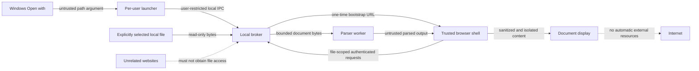

# Security boundaries and ownership

Status: design requirements for step 2; no security control is implemented or proven yet.

## Data flow

The diagram describes authority, not a final threading or authentication implementation. A worker improves responsiveness but is not automatically a security sandbox. Parsers and their output remain untrusted at the rendering boundary.

## Protected assets

Original file bytes, other unopened files, file-to-session mappings, bootstrap/session credentials, the application's trusted DOM, and CPU/memory/disk availability. File paths and document names can themselves be sensitive. Application logs must not become a document-content or credential archive.

## Boundary rules

| Boundary | Required rule | Why it exists | Tests |
|---|---|---|---|
| Windows to launcher | Treat arguments as data; validate regular files; reject unsupported device/directory inputs; no shell-string interpolation | Spaces, punctuation, or option-like names must not execute commands or change launch behavior | PATH-01/02/03, SC-02 |
| Launcher to broker | Restrict IPC to the intended Windows user and validate each request; do not expose a public HTTP “open arbitrary path” method | A website must not turn localhost into a filesystem proxy | SEC-01, SEC-07 |
| Filesystem to broker | Open read-only, establish file identity, and detect changes or read a consistent snapshot; never derive filesystem paths from arbitrary URL segments | Prevent wrong-file reads, path traversal, and mixed versions during streaming | SC-06, SEC-02 |
| Browser/website to broker | Loopback binding, expected Host validation, endpoint-specific Origin policy, file-scoped authorization on every byte/metadata/range read | Loopback and CORS alone do not establish permission | SEC-01/02/03 |
| Bootstrap to session | Short expiry and atomic single redemption; credentials absent from logs and removed from visible URL; refresh uses session authorization | Avoid replay without breaking repeated reads | SEC-03, SC-03 |
| File A to file B | Enforce scope server-side on metadata, bytes and range endpoints; no authorization merely because a tab knows another file ID | Multiple documents share the broker | SEC-02 |
| Parser to trusted shell | Treat strings, URLs, metadata, errors and generated HTML as untrusted; sanitize URLs/HTML and isolate document styles/content | Converted files can contain active markup or application-looking UI | SEC-04 |
| Document display to application/network | No document scripts, automatic external loads, top navigation, parent-DOM access or unintended local-file resolution | Reading a document must not grant app authority | SEC-04/05 |
| Compressed/decoded content to resources | Enforce cumulative expanded-byte, entry-count, pixel, cell, time and concurrency budgets, not only compressed file size | Small files can cause large resource consumption | SEC-06 |
| Runtime to disk/logs | Minimal logging; scoped temporary files; cleanup on normal exit and recovery; originals remain unchanged | Privacy includes residue after a crash | SEC-08, SC-06/07 |
| Dependencies to distribution | Pin and review dependencies, bundle offline assets, include notices, sign the release package | The parser and installer supply chain has application privileges | REL-12/14 |

## Design traps found during review

1. **HTTP metadata can leak too.** Authenticate names, lengths, previews, and HEAD/range requests as well as full file downloads. Do not allow unauthenticated errors to reveal whether a guessed file ID exists.
2. **Initial navigation and authenticated API calls are different.** Top-level browser GETs may have no Origin header. Define endpoint-specific handling rather than rejecting all missing Origins or accepting them everywhere. State-changing requests need their own verification.
3. **Cookies are not port-scoped.** A new localhost port is not a cookie-isolation strategy. Credential transport, refresh, and document-origin separation must be resolved together before step 5 is accepted.
4. **Sandbox settings can cancel isolation.** Do not grant both script and same-origin privileges to same-origin document content. Use narrowly scoped messaging with validated sender identity and message shape when isolated displays must communicate.
5. **HTML sanitization alone does not block remote fetches.** URLs in images, CSS, SVG, fonts, and EPUB resources need explicit policy plus a restrictive content-security policy. Test attempted network requests, not only completed requests.
6. **Extension checks are only routing hints.** Validate actual container/signature structure. HTML named `.pdf` must never execute as trusted application content.
7. **Opening and later reopening a path introduces races.** Prefer a stable read handle or defined snapshot strategy; detect mutation before serving inconsistent ranges. A filename is not file identity.
8. **Idle cleanup conflicts with sleeping/background tabs.** Define session expiry and recovery without treating one missed heartbeat as closure. Step 1's five-minute grace starts after expiry and therefore does not itself bound total time after tabs close; step 6 must explicitly set/test expiry and cleanup timing.
9. **No-CDN does not alone prove offline privacy.** Embedded document resources and dependency behavior also require network inspection.

## Authority limits and open decisions

The application is not intended to defend against an administrator or malware already controlling the same Windows account. Unrelated web origins and malicious input documents are in scope. Other Windows users must not access the launcher IPC; HTTP access remains credential-protected even on the same machine.

No library or protocol choice is fixed by this map. Step 3 proves packaged launching. Step 4 measures parsers. Step 5 must settle credential storage, document isolation, HTTP request policies, IPC ACLs and file consistency. No security checkbox passes until the corresponding installed-app test runs.

## Primary references checked

- [W3C EPUB 3.3](https://www.w3.org/TR/epub-33/) — container and publication structure; informs the EPUB fixtures.
- [MDN iframe reference](https://developer.mozilla.org/en-US/docs/Web/HTML/Reference/Elements/iframe) — sandbox privileges and navigation behavior; informs document isolation.
- [OWASP file upload guidance](https://cheatsheetseries.owasp.org/cheatsheets/File_Upload_Cheat_Sheet.html) — content validation and expanded-size limits. Although this app reads local files, the untrusted-parser and resource-exhaustion concerns apply.
